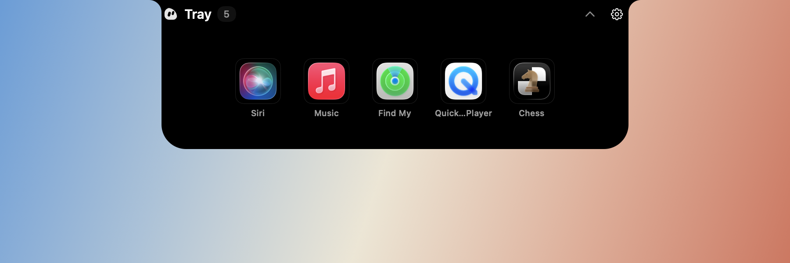
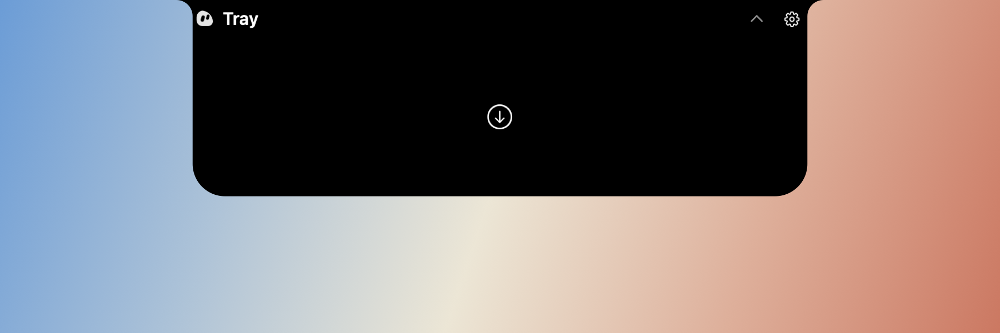
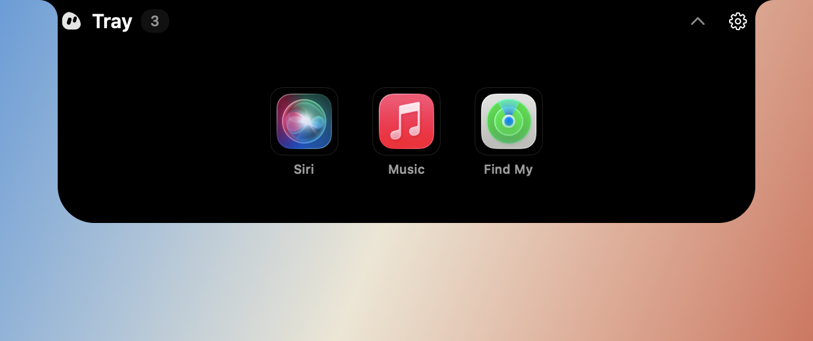
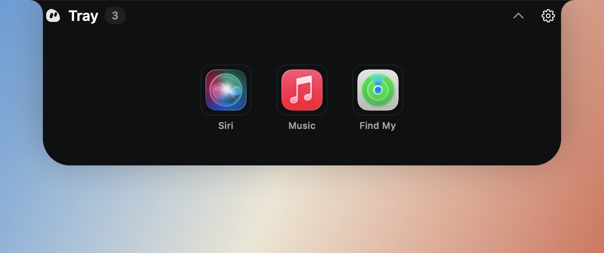
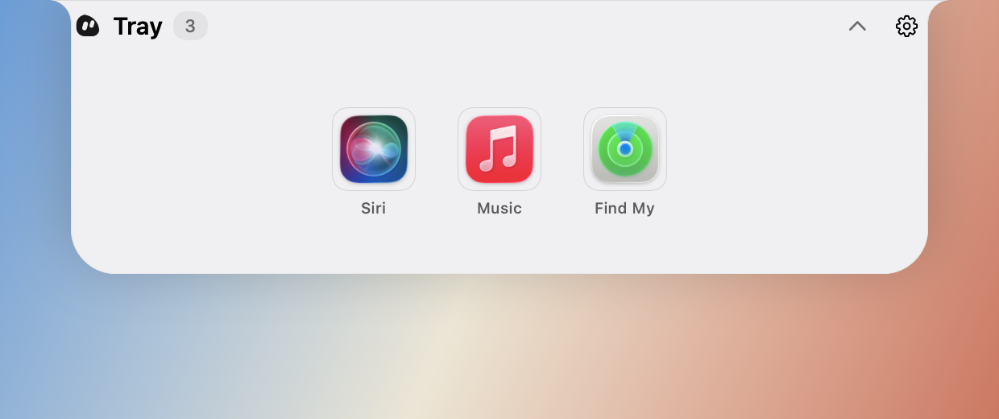
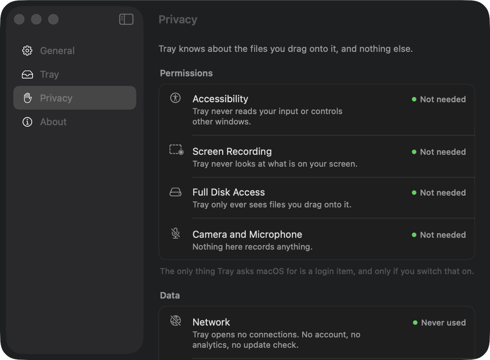

<p align="center">
  <picture>
    <source media="(prefers-color-scheme: dark)" srcset="docs/assets/readme/logo-dark.svg">
    
  </picture>
</p>

<h1 align="center">Tray</h1>

<p align="center">
  A shelf at the top of your screen.<br>
  Drag files in, drag them back out, and nothing on disk moves.
</p>

<p align="center">
  <a href="#install">Install</a> ·
  <a href="#what-it-does">What it does</a> ·
  <a href="#your-files-stay-where-they-are">Privacy</a> ·
  <a href="#build-it-yourself">Build</a> ·
  <a href="CHANGELOG.md">Changelog</a> ·
  <a href="docs/SPEC.md">Spec</a>
</p>

<p align="center">
  <a href="https://github.com/DarkZeen/Tray/releases"></a>
  <a href="https://github.com/DarkZeen/Tray/releases"></a>
  <a href="https://github.com/DarkZeen/Tray/actions/workflows/ci.yml"></a>
  <a href="#what-you-need"></a>
  <a href="LICENSE"></a>
</p>

<p align="center">
  
</p>

Moving a file between two windows on a Mac usually means arranging both of them on screen first. Tray removes that step. Throw the file at the top of your screen, go find the window you actually wanted, and pull the file back out when you get there.

That is the entire product. There is no media player, no clipboard history, no weather, no AI. One shelf, doing one thing.

## What it does

- **Drag files up, and the shelf opens to catch them.** Aim roughly at the top centre of the screen — the drop target is much wider than the shelf looks, so you do not have to be precise. Drop several at once if you like.
- **Nothing moves on disk.** The shelf holds a reference to the file, not a copy. Your photo stays on the Desktop the whole time it is sitting in the tray.
- **Drag them back out into anything.** A Finder window, a Save dialog, an upload field, another app. It is a real macOS drag, so every destination that takes a file takes this one.
- **Or use the keyboard.** Click an item and press Delete to take it off the shelf, Space to Quick Look it, ⌘C to copy it, ⌘V to paste files in from anywhere. ⌘-click picks out several, ⌘A takes the lot, arrow keys walk along, Escape closes.
- **It fits around the notch.** Nothing the shelf shows sits under the camera housing — the housing is a hole in the display, not a dark rectangle, so anything drawn there is simply gone. The shelf spans its full width where it meets the top edge and draws in over a shoulder on each side, the same move the hardware makes where the notch meets the bezel.
- **It knows about the notch.** On a MacBook with a camera housing the closed shelf *is* the housing — same width, same height, hanging off the same edge. On any other display it recreates one, scaled to the menu bar that display has, so the shelf looks the same on a MacBook Pro and a 5K panel. Both are measured from the display, never hardcoded, so external monitors and scaling changes are just other numbers.
- **Every display gets one.** Drag toward the top of your second monitor and that monitor's shelf answers. Connect or disconnect a screen and the shelves follow.
- **Three surfaces.** Island by default — the same opaque black as the camera housing, with nothing showing through, no shadow and no edge, so on a MacBook the shelf reads as the notch itself growing. Graphite, if you would rather it was dark and slightly translucent. Or light, if you would rather it sat with a pale desktop than against it.
- **It stays out of the way.** Empty and idle, the tray is a faint line you can ignore. Holding something, it is a small pill with a dot per file. It opens as the pointer arrives and closes as the pointer leaves. Hovering and dropping never take focus, so throwing a file at it does not pull you out of whatever you were doing — only clicking into it does, and only so the keyboard has something to talk to.
- **Secondary click for the rest.** Remove from Tray, Reveal in Finder, Quick Look. Three items, because it is a shelf and not a file manager.

<p align="center">
  
  
</p>

<p align="center">
  
  
  
</p>

## Settings

Four pages, and most of them you will open once. General has Launch at Login and the menu bar icon; Tray has what opens the shelf, how long it waits before closing, and whether file names show. Opening Tray while it is already running opens this window — an app with no Dock icon has to have a front door somewhere.

By default the shelf closes the moment the pointer leaves, and a tray you have clicked into waits for a click elsewhere so that reaching for the keyboard does not close it. Both are settings: *Close after* goes up to three seconds, and *Stay open after a click* turns the second behaviour off entirely. *Surface* picks between the three looks, *Shelf size* opens it compact, spacious or at a width and height you set yourself — with no bracket beyond the camera housing, the edges of the display and whatever the icons need — *Icon size* sets how large each file is drawn, *Header padding* how far the name and buttons sit from the sides and *Position* whether the files sit left, centred or right, and *Outline the drop area* adds a dashed border showing where a dropped file will land, with a slider for how far inside the edge it sits. *Open after a drop* decides whether the shelf stays up for a moment to show what landed.

Anything that changes how the tray looks opens the tray while you change it, so a size slider is something you watch rather than something you guess at. It closes on its own a couple of seconds after you stop.

The Privacy page is the one worth a look. It is the same page other menu bar apps use to explain which permissions they need — except that Tray's version is a list of the ones it does not.

<p align="center">
  
</p>

## Your files stay where they are

Tray knows about the files you drag onto it and nothing else. No account, no analytics, no network — the app never opens a connection, so there is nothing to opt out of.

It also asks for no permissions at all. Not Full Disk Access, not Accessibility, not Screen Recording. A file arrives because you dragged it, and that is the only way anything gets in.

The shelf lives in memory for as long as the app is running. Quit Tray and the shelf is empty; every file it was holding is exactly where you left it.

## What you need

- A Mac with Apple Silicon
- macOS 26 or newer

## Install

Download the disk image from the [releases page](https://github.com/DarkZeen/Tray/releases) and drag Tray into Applications.

Release builds are signed with an Apple Developer ID and notarized, so macOS opens them without complaint. If you are running a build you made yourself, macOS will ask you to confirm the first launch — see [troubleshooting](docs/TROUBLESHOOTING.md).

Tray has no Dock icon. It lives in the menu bar, and at the top of your screen.

## Build it yourself

```sh
git clone https://github.com/DarkZeen/Tray.git
cd Tray
./Scripts/setup-signing.sh   # once: a stable local signing identity
./Scripts/build.sh --install # compile, assemble, sign, install, launch
```

Xcode Command Line Tools are the only requirement — there is no `.xcodeproj`, and nothing here needs a paid Apple Developer account. `./Scripts/setup-signing.sh` is worth running before your first build: without a stable signature macOS treats every rebuild as a different app and quietly drops the Launch at Login setting.

```sh
./Scripts/build.sh            # build into build/
./Scripts/build.sh --dev      # separate bundle id, coexists with an installed release
./Scripts/build.sh --debug    # debug build; TRAY_DEBUG=1 then shows a geometry overlay
./Scripts/test.sh             # run the tests
./Scripts/test.sh --previews  # also render the interface into build/previews
./Scripts/create-dmg.sh       # build the disk image into dist/
```

The [contributing guide](CONTRIBUTING.md) covers the layout and the conventions. [docs/SPEC.md](docs/SPEC.md) is the specification the app was built against, kept in the repository because it is the reason most decisions here are the way they are.

## When something misbehaves

The [troubleshooting guide](docs/TROUBLESHOOTING.md) covers the usual cases: the app blocked on first launch, Launch at Login not sticking, the shelf not appearing over a full-screen app, thumbnails showing as plain icons.

## Documentation

- [Troubleshooting](docs/TROUBLESHOOTING.md), the common fixes
- [Privacy](docs/PRIVACY.md), what does and does not leave your Mac
- [Contributing](CONTRIBUTING.md), build, layout and conventions
- [Specification](docs/SPEC.md), what was built and why
- [Changelog](CHANGELOG.md)

## License

[MIT](LICENSE).
